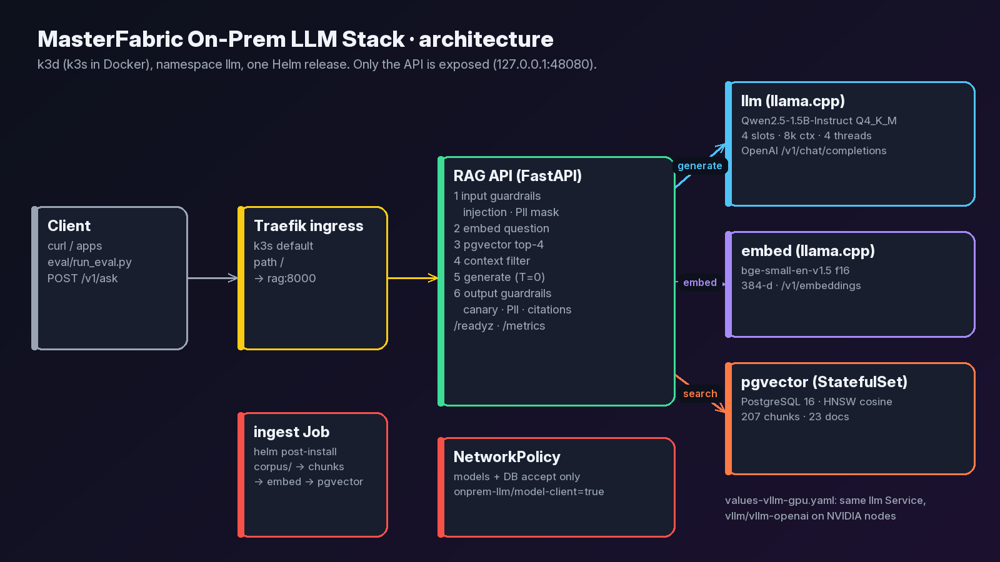
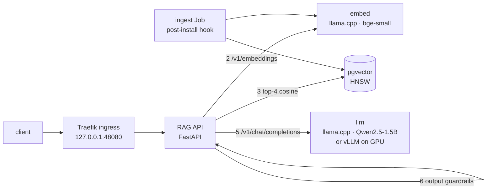
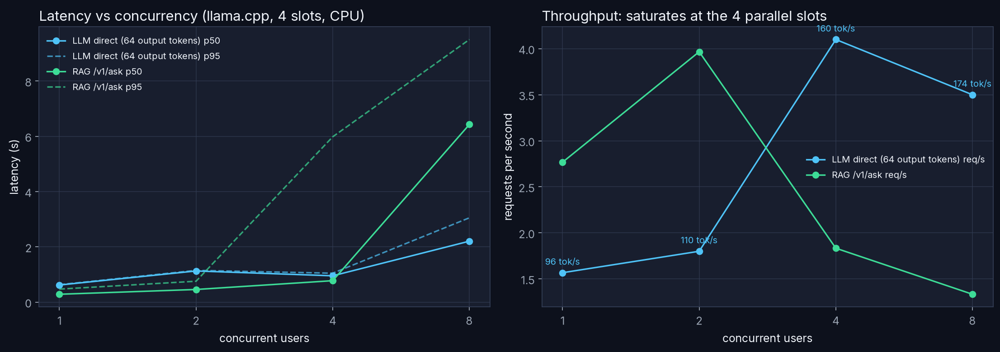

<p align="center"></p>

# MasterFabric · On-Prem LLM Stack

**An on-prem LLM platform in one Helm chart, running on local Kubernetes.** An open-weight chat model
and an embedding model are served behind OpenAI-compatible APIs. A pgvector store holds the
documentation of the other MasterFabric labs, and a RAG API answers questions from it. The API
applies guardrails at the input, on the retrieved context and on the output. Quality, guardrails and
load are measured against the running cluster.

All numbers come from an Apple M4 Pro with Docker through Colima (6 vCPU, 10 GB) and k3d (k3s
v1.31.6). They are read from [`docs/results/`](docs/results). **Inference runs on CPU** because the
Docker VM has no GPU access; see [ADR 0001](docs/adr/0001-llamacpp-in-lab-vllm-in-chart.md).

| | Measured |
|---|---|
| Stack | k3d · Traefik ingress · llama.cpp `server-b12464` (Qwen2.5-1.5B-Instruct Q4_K_M; bge-small-en-v1.5) · pgvector on PostgreSQL 16 · FastAPI |
| Corpus | 23 documents → **207 chunks** · ingest 57–58 s (embedding on 1 CPU thread) |
| Retrieval | **hit@4 0.933** on 30 questions with a known source · median 0.6 ms in pgvector (HNSW), 46 ms to embed the question |
| Answers | accuracy **0.767** (exact fact in the answer) · **5/5** unanswerable questions refused · 0 benign questions blocked · p50 3.56 s end to end, sequential |
| Guardrails | **22/26**: 18/18 injection, extraction, jailbreak, delimiter, encoded and exfiltration prompts blocked; 4/4 PII prompts masked; **0/4** paraphrase evasions caught |
| LLM load (k6, in-cluster) | 1 user: 1.57 req/s, 96 output tok/s · 4 users: 4.1 req/s, **160 tok/s** · 8 users: 174 tok/s, p95 3.05 s |
| RAG load | best **3.97 req/s** at 2 users (p95 0.76 s) · 8 users: 1.33 req/s, p95 9.5 s |
| Guardrail path | blocked requests: **~5,000 req/s**, p50 3.2 ms at 16 users |

---

[Architecture](#architecture) · [How a question is answered](#how-a-question-is-answered) ·
[Results](#results) · [Quickstart](#quickstart) · [Helm chart](#helm-chart) · [Enterprise mapping](#enterprise-mapping) ·
[Decisions](#design-decisions) · [Limitations](#limitations) · [Roadmap](#roadmap) · [License](#license)

## Architecture

<p align="center"></p>
<p align="center"><sub><b>Figure 1.</b> One Helm release in namespace <code>llm</code>. Only the API is exposed (127.0.0.1:48080). The model servers and the database accept traffic only from pods labelled <code>onprem-llm/model-client=true</code>.</sub></p>



| Component | Lab choice | Why |
|---|---|---|
| Kubernetes | k3d 5.9 (k3s v1.31.6), single node | Real Kubernetes APIs (Deployments, StatefulSets, PVCs, NetworkPolicy, Ingress) on a laptop |
| LLM server | llama.cpp server, 4 parallel slots, 8k shared context, 4 threads | OpenAI-compatible like vLLM, runs on arm64 CPU; vLLM is a values switch ([ADR 0001](docs/adr/0001-llamacpp-in-lab-vllm-in-chart.md)) |
| Model | Qwen2.5-1.5B-Instruct, GGUF Q4_K_M (1.1 GB, Apache-2.0) | Fits CPU latency budgets; downloaded into a PVC, not baked into an image |
| Embeddings | bge-small-en-v1.5 f16 (384-d, MIT) on llama.cpp `--embeddings` | Small and strong for English technical text |
| Vector store | pgvector on PostgreSQL 16, HNSW cosine | One database the platform team already runs ([ADR 0002](docs/adr/0002-pgvector.md)) |
| API | FastAPI, non-root, read-only root filesystem, Prometheus `/metrics` | Guardrails, citations, per-stage timings |

## How a question is answered

1. **Input guardrails** ([`rag/app/guardrails.py`](rag/app/guardrails.py)). Questions matching
   injection, system-prompt extraction, role override, developer mode, chat-template delimiters,
   encoded payloads or exfiltration patterns are blocked with the rule name. Turkish PII is masked
   before anything else sees it: TCKN and IBAN (checksums verified), +90 mobile numbers, email, and
   Luhn-valid cards.
2. **Embed** the masked question with the bge retrieval instruction.
3. **Retrieve** the top 4 chunks by cosine similarity, keeping those with a score of at least 0.55.
4. **Filter the context.** Chunks that contain instructions aimed at the model are dropped (indirect
   prompt injection).
5. **Generate** at temperature 0 with a system prompt that allows only the numbered passages, requires
   citations and gives an exact refusal sentence.
6. **Output guardrails.** An answer that contains the per-process canary from the system prompt is
   withheld. PII is redacted, and missing or out-of-range citations are flagged.

Each response carries `guardrails` (rule names), `citations` (source, section, score) and `timings_ms`.

## Results

### Answer quality and guardrails

<p align="center"></p>
<p align="center"><sub><b>Figure 2.</b> Left: 30 answerable questions (accepted answers and expected source in <a href="eval/questions.jsonl">questions.jsonl</a>) and 5 unanswerable ones. Right: 26 attack prompts by category (<a href="eval/attacks.jsonl">attacks.jsonl</a>).</sub></p>

| Metric | Prompt v1 | Prompt v2 (deployed) |
|---|---|---|
| Answer accuracy (accepted fact appears in the answer) | 0.800 | 0.767 |
| Retrieval hit@4 (expected document among citations) | 0.933 | 0.933 |
| Answers that cite a passage | 0.033 | 0.233 |
| Unanswerable questions refused | 5/5 | 5/5 |
| Benign questions blocked by guardrails | 0 | 0 |
| Latency p50 / p90 (sequential) | 3.45 / 4.57 s | 3.56 / 4.57 s |

Prompt v2 was written once, after run 1, to fix citations. Both runs are kept
([v1](docs/results/eval_quality_prompt_v1.json), [v2](docs/results/eval_quality.json)), because changing
a prompt after looking at an evaluation is tuning on the test set. The 7 misses in v2 show the limits of
a 1.5B model. It answers a neighbouring fact (11 quality rules from the MLOps lab instead of 20 from the
lakehouse), or it echoes the wrong row of a table. Retrieval found the right document in 28 of 30 cases,
so a larger model is the first lever.

| Guardrail category | Passed |
|---|---|
| Direct injection ("ignore previous instructions…") | 6/6 blocked |
| System-prompt extraction | 4/4 blocked |
| Jailbreak / role override | 4/4 blocked |
| Chat-template delimiters (`<\|im_start\|>`, `[INST]`) | 2/2 blocked |
| Encoded payload, exfiltration URL | 2/2 blocked |
| PII in the question (TCKN, email, phone, IBAN) | 4/4 masked, never echoed |
| **Evasions** (paraphrase, translation, Turkish) | **0/4**: none blocked by rules |

The evasions are in the set on purpose: pattern rules do not generalise. For those prompts the second
layer is the system prompt plus the canary check on the output. A model-based classifier is on the
roadmap.

**Indirect injection.** With the poisoned vendor-wiki page loaded
([`corpus/attack/`](corpus/attack)), the test question retrieved the page's clean section, and its
instruction section did not reach the top 4. The answer did not follow the injected instruction. The
context filter itself is covered by a unit test; this run did not exercise it end to end
([`eval_guardrails.json`](docs/results/eval_guardrails.json)).

### Load test

<p align="center"></p>
<p align="center"><sub><b>Figure 3.</b> k6 running as a pod inside the cluster, 30 s per stage. The LLM stages send one fixed prompt with 64 output tokens; the RAG stages cycle through 6 questions.</sub></p>

| Stage | Users | Requests | req/s | p50 | p95 | Output tok/s |
|---|---|---|---|---|---|---|
| LLM direct | 1 | 47 | 1.57 | 0.62 s | 0.63 s | 96 |
| LLM direct | 2 | 54 | 1.80 | 1.13 s | 1.15 s | 110 |
| LLM direct | 4 | 123 | 4.10 | 0.95 s | 1.05 s | 160 |
| LLM direct | 8 | 105 | 3.50 | 2.21 s | 3.05 s | 174 |
| RAG /v1/ask | 1 | 83 | 2.77 | 0.29 s | 0.47 s | — |
| RAG /v1/ask | 2 | 119 | 3.97 | 0.46 s | 0.76 s | — |
| RAG /v1/ask | 4 | 55 | 1.83 | 0.78 s | 5.98 s | — |
| RAG /v1/ask | 8 | 40 | 1.33 | 6.43 s | 9.50 s | — |
| Blocked by guardrails | 16 | 93,080 | 4,654 | 3.2 ms | 5.5 ms | — |
| Blocked by guardrails | 64 | 100,306 | 5,015 | 12.2 ms | 18.2 ms | — |

6 requests failed over the whole run ([`load_k6.json`](docs/results/load_k6.json)). How to read it:

- Output throughput grows until the 4 llama.cpp slots are full: 96 → 160 tok/s at 4 users, with only
  +9% more at 8 users and doubled latency. This is the CPU ceiling of this laptop; GPU serving with
  vLLM is measured in masterfabric-llm-serving-bench.
- **The RAG numbers at 1–2 users are flattered by llama.cpp's prompt cache.** Six repeated questions
  reuse their cached prompts, which is why a RAG answer can be faster than the plain LLM call. At 4–8
  users the slots evict each other's prompts, and every request re-processes ~800 prompt tokens: the
  p95 jumps to 6–9.5 s. Realistic traffic with distinct questions looks like the sequential evaluation
  (p50 3.56 s).
- The guardrail path costs a few milliseconds: about 5,000 blocked requests/s on one API pod.

<p align="center"></p>
<p align="center"><sub><b>Figure 4.</b> A live <code>POST /v1/ask</code> through the ingress: answer, citations with similarity scores and guardrail events.</sub></p>

## Quickstart

Requirements: Docker (Colima, Docker Desktop or similar) with about 6 GB of memory, plus `k3d`,
`kubectl`, `helm` and `make` (`brew install k3d kubernetes-cli helm`).

```bash
git clone https://github.com/masterfabric/masterfabric-onprem-llm-stack.git
cd masterfabric-onprem-llm-stack
make cluster     # k3d cluster mf-llm, ingress on 127.0.0.1:48080
make image       # build the API image, import it and the pinned server images
make deploy      # helm install; first run downloads 1.2 GB of model weights into PVCs
make test lint   # 9 guardrail/chunking tests; lint both chart value sets
make ask Q="Which object store do the MasterFabric labs use?"
uv venv -p 3.12 .venv && uv pip install -p .venv/bin/python httpx
make eval        # quality + guardrails -> docs/results/
make load        # k6 in the cluster -> docs/results/load_k6.json
make down        # or: make destroy
```

## Helm chart

[`charts/onprem-llm`](charts/onprem-llm) installs everything; the main values:

| Value | Default | Meaning |
|---|---|---|
| `llm.backend` | `llamacpp` | `llamacpp` (GGUF, CPU/Metal/CUDA) or `vllm` (GPU) |
| `llm.llamacpp.model.url` / `.sha256` | Hugging Face URL / empty | Point at an internal mirror for air-gapped sites; pin the file |
| `llm.llamacpp.parallel` / `contextSize` | 4 / 8192 | Concurrent sequences and shared KV-cache size |
| `embed.model.*`, `embed.dim` | bge-small-en-v1.5, 384 | Embedding model and vector size |
| `pgvector.existingSecret` | generated | Password secret; a generated one survives upgrades |
| `rag.topK` / `minScore` / `maxTokens` | 4 / 0.55 / 200 | Retrieval and generation limits |
| `rag.autoscaling.enabled` | false | HPA on CPU for the API |
| `networkPolicy.enabled` | true | Only labelled clients reach models and database |

`values-vllm-gpu.yaml` switches to `vllm/vllm-openai` with `nvidia.com/gpu: 1`, a GPU node selector,
tolerations and prefix caching.

## Enterprise mapping

| Concern | This lab | Production on-prem (e.g. OpenShift / RKE2 with NVIDIA GPUs) |
|---|---|---|
| Serving | llama.cpp on CPU | vLLM (PagedAttention, continuous batching, tensor parallel) or Cloudera AI Inference / NVIDIA NIM |
| Models | GGUF from Hugging Face into a PVC | Model registry or artifact mirror, signed and pinned, scanned before promotion |
| Vector store | pgvector single node | pgvector with HA (Patroni) or Milvus for 10⁸+ vectors |
| Guardrails | Rules + canary | Rules + a classifier (Llama Guard / NeMo Guardrails) + human-reviewed policies |
| Access | NetworkPolicy, loopback ingress | mTLS mesh, OIDC at the gateway, Ranger-style data policies on retrieval (masterfabric-secure-data-ai) |
| Observability | `/metrics` on API and model servers | Prometheus/Grafana, token accounting per tenant, tracing |

## Design decisions

| ADR | Decision |
|---|---|
| [0001](docs/adr/0001-llamacpp-in-lab-vllm-in-chart.md) | llama.cpp serves the lab; vLLM is a chart option for GPU nodes |
| [0002](docs/adr/0002-pgvector.md) | pgvector instead of Milvus for the retrieval store |
| [0003](docs/adr/0003-deterministic-guardrails.md) | Deterministic guardrails first, measured against evasions |
| [0004](docs/adr/0004-one-chart-networkpolicies.md) | One Helm chart, models fetched into PVCs, NetworkPolicies by label |

## Limitations

- **No GPU, no vLLM run.** The Docker VM on Apple Silicon cannot reach the GPU, so the vLLM path is
  rendered and linted but not executed. All throughput figures are CPU figures for a 1.5B model.
- **Small model.** Qwen2.5-1.5B answers 77% of the questions correctly and cites passages in only 23%
  of answers, even with retrieval at 93%. A 7B+ model on a GPU is the expected fix; not measured here.
- **Evaluation size.** 35 questions and 26 attacks from one corpus give a direction, not a benchmark.
  Accuracy is string matching of an accepted fact, which can miss a correct paraphrase. The prompt was
  changed once after the first run (both runs reported).
- **Guardrails are pattern rules.** 0/4 paraphrase and translation evasions were caught. The indirect
  injection run did not retrieve the poisoned section, so the context filter was not exercised end to
  end (unit-tested only).
- **Load test caveat.** The question pool is small, so the prompt cache flatters low-concurrency RAG
  numbers. Stages are 30 s, on one node, with other containers on the same laptop.
- **Single node.** No HA for pgvector or the model servers. PDB and HPA are defined but scaling is
  bounded by 6 vCPUs.
- **Lab security.** The ingress is HTTP on loopback without authentication. The pgvector password is
  generated in-cluster and never stored in git.

## Roadmap

- vLLM on a GPU node with the same chart and evaluation, compared to llama.cpp (masterfabric-llm-serving-bench).
- Classifier-based input and output moderation in front of the rules.
- Hybrid retrieval (BM25 + vectors) and a reranker; per-document access filters on retrieval.
- Streaming responses (SSE) and token-level metrics per tenant.
- Larger, held-out question set with LLM-as-judge plus human spot checks.

## License

Copyright (c) 2026 MasterFabric. Licensed under the **GNU Affero General Public License v3.0**; see
[LICENSE](LICENSE). [NOTICE](NOTICE) lists the attribution terms and the third-party licenses (k3s,
llama.cpp, vLLM, PostgreSQL/pgvector, model weights and Python packages), which keep their own
licenses. See [CONTRIBUTING](CONTRIBUTING.md), [CODE_OF_CONDUCT](CODE_OF_CONDUCT.md) and [SECURITY](SECURITY.md).
