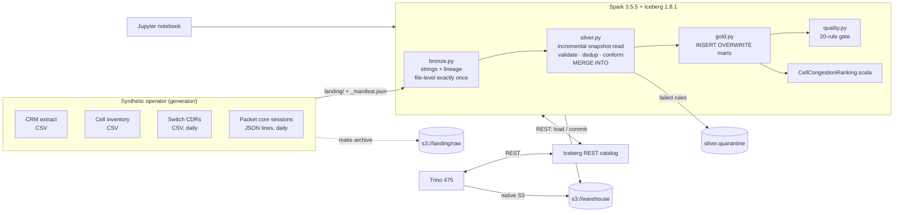
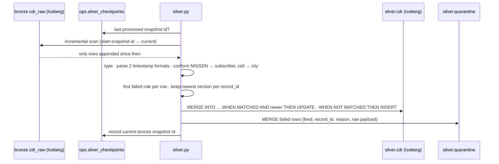

<p align="center"></p>

# MasterFabric · Lakehouse Lab

**A complete lakehouse you can run on one laptop, fed by a synthetic mobile operator.**
Raw switch CDRs, packet-core data sessions, a CRM extract and the radio cell inventory are landed,
cleaned and turned into business marts on **Apache Iceberg** tables, written by **Apache Spark**,
queried interactively by **Trino**, stored in **S3-compatible object storage**. Every Iceberg feature
the README talks about is exercised on the real tables, and every number below was measured on an
Apple M4 Pro.

| | |
|---|---|
| **Storage** | RustFS (S3 API + console) · `s3://warehouse`, `s3://landing` |
| **Table format** | Apache Iceberg v2 · REST catalog |
| **Processing** | Spark 3.5.5 (PySpark + one Scala job) · medallion bronze → silver → gold |
| **Interactive SQL** | Trino 475 on the same catalog (the Impala role) |
| **Quality** | 20-rule gate with reconciliation against the producer's manifest |
| **Proof** | 14 tests · scale benchmark 0.26 M → 2.1 M rows · screenshots and charts from real runs |

> First of a series of MasterFabric data and AI platform repositories. This one covers the
> lakehouse and big data processing layer; streaming, MLOps and on-prem LLM serving follow in
> their own repositories (see [Roadmap](#roadmap)).

## Contents

[Why](#why-this-lab-exists) · [Architecture](#architecture) · [Quickstart](#quickstart) ·
[Pipeline walkthrough](#pipeline-walkthrough) · [Iceberg features](#iceberg-features-on-real-tables) ·
[Trino](#interactive-sql-with-trino) · [Measured results](#measured-results) ·
[Screenshots](#screenshots) · [Cloudera mapping](#mapping-to-a-cloudera-cdp-estate) ·
[Decisions](#design-decisions) · [Data model](#data-model) · [Limitations](#limitations) ·
[Roadmap](#roadmap) · [Build timeline](docs/TIMELINE.md)

## Why this lab exists

Most lakehouse examples load a clean CSV into a table and stop. Real platforms fail in the
gaps between the boxes: a switch retransmits a record, a mediation system delivers yesterday's
file today, a vendor changes its timestamp format, a correction feed re-rates a thousand calls,
a table that was partitioned by month is suddenly too big, and after a few weeks of small
MERGE batches every query is slow. This lab builds those problems in on purpose and then shows,
with numbers, how the architecture deals with each one:

- **No silent data loss.** Bronze keeps every raw value as a string; silver sends every record
  that breaks a rule to a quarantine table with the rule's name and the raw payload.
- **No double counting.** Duplicates and late records converge to exactly one row through
  `MERGE INTO` on the business key, with "newer ingestion wins".
- **Provable completeness.** The generator writes a manifest of what it produced and which
  defects it injected; the quality gate checks that the pipeline accounts for every record.
- **Tables that can change.** Schema and partition evolution are metadata-only commits; time
  travel answers "what did this table say before the corrections?"
- **Tables that stay fast.** The small-file problem is created, measured, then removed by
  compaction and snapshot expiry.

## Architecture

<p align="center"></p>

*Five containers, all bound to `127.0.0.1`. Spark writes Iceberg tables and commits them through
the REST catalog; data and metadata files go to object storage through Iceberg's `S3FileIO`.
Trino resolves the same `lake.<namespace>.<table>` names through the same catalog, so analysts
query exactly the tables the pipeline published.*



### How silver stays incremental and idempotent



Re-running any step is safe: bronze skips files already in `ops.ingest_log`, silver finds no new
snapshot and does nothing, gold overwrites atomically. That is what lets an orchestrator retry
freely.

## Quickstart

Requirements: Docker with Compose v2 (Docker Desktop, or Colima on macOS without admin rights),
GNU make, ~10 GB of free disk for images, and Python 3.10+ only for the optional tooling
(tests on the host, charts, screenshots).

```bash
git clone https://github.com/masterfabric/masterfabric-lakehouse-lab.git
cd masterfabric-lakehouse-lab
make up            # creates .env from .env.example, builds the Spark image, starts 5 services
make pipeline      # generate → bronze → silver → gold → quality   (~35 s at scale 1)
make demos         # Iceberg: evolution, late corrections, time travel, maintenance
make gold quality  # rebuild marts after the corrections and re-run the gate
make scala         # Scala ranking job
make test          # 8 unit tests on the host + 6 Spark/Iceberg tests in the container
```

| Service | URL | Notes |
|---|---|---|
| S3 console (RustFS) | http://127.0.0.1:19001/rustfs/console/ | credentials from `.env` |
| S3 API | http://127.0.0.1:19000 | path-style |
| Iceberg REST catalog | http://127.0.0.1:18181/v1/config | |
| Trino UI | http://127.0.0.1:18080/ui/ | any user name, no password |
| Spark History Server | http://127.0.0.1:18090 | every job of the run |
| Jupyter | http://127.0.0.1:18888 | inside the Spark container |

Bigger data: `make pipeline SCALE=4` (8,000 subscribers, ~1 M raw rows). Full benchmark:
`make bench` (scales 1, 2, 4, 8, then restores the scale-1 demo state). Start over: `make reset`.

Optional host tooling for charts, screenshots and Trino scripts:

```bash
uv venv -p 3.12 .venv && uv pip install -p .venv -e '.[tools]' && .venv/bin/python -m playwright install chromium
make trino-sql notebook screenshots assets
```

## Pipeline walkthrough

<p align="center"></p>

*The scale-1 run, with the counts read from `docs/results/pipeline_scale1.json`: 2,599
duplicates were injected and 2,599 were removed; every malformed record is in quarantine with
the rule it broke.*

### 1. Generate a realistic operator: `generator/telco_gen.py`

Deterministic per seed, standard library only. Scale 1 means 2,000 subscribers, 120 cells and 7
days. Subscribers have a hidden churn propensity that changes their behaviour (fading usage,
more dropped calls); it is exported only as held-out labels for later ML work. The generator
injects the defects production feeds actually have and writes what it did to
`_manifest.json`:

```json
"clean":    { "cdr_records": 124286, "session_records": 131064, "subscribers": 2000, "cells": 120 },
"injected": { "duplicates": 2599, "late": 3726, "bad_msisdn": 232, "neg_duration": 89,
              "unknown_cell": 557, "alt_ts_format": 12745 }
```

### 2. Bronze: land without losing anything

`lakehouse/bronze.py` reads CSV with schema inference off and JSON lines through an explicit
all-string schema, adds `_source_file`, `_source_date`, `_batch_id` and `_ingested_at`, and
appends to Iceberg v2 tables partitioned by source date. `ops.ingest_log` makes ingestion
exactly-once per file; a second run reports `new_files: 0`.

### 3. Silver: type, validate, deduplicate, conform, upsert

`lakehouse/rules.py` holds the I/O-free rules (unit tested); `lakehouse/silver.py` applies them
incrementally. Rule results on the scale-1 run:

| Feed | Rule | Quarantined | Injected by the generator |
|---|---|---:|---:|
| cdr | `invalid_msisdn` | 232 | 232 |
| cdr | `negative_duration` | 89 | 89 |
| cdr | `unknown_cell` | 276 | 557 across both feeds* |
| sessions | `unknown_cell` | 280 | |

\* 276 + 280 = 556: one CDR had an unknown cell *and* a malformed MSISDN and is reported under
the first failed rule. The 12,745 timestamps in the vendor's `dd/MM/yyyy` format all parsed;
none were quarantined.

### 4. Gold: marts with a documented grain

| Mart | Grain | Rows (scale 1) | Built with |
|---|---|---:|---|
| `gold.daily_subscriber_usage` | subscriber × day | 13,860 | INSERT OVERWRITE, partitioned by day |
| `gold.cell_hourly_load` | cell × hour | 19,377 | Little's-law concurrency × panel weight ÷ capacity |
| `gold.churn_features` | subscriber | 2,000 | trend, drop rate, throughput, congestion exposure, baseline score |
| `gold.cell_congestion_ranking` | cell | 120 | Scala Dataset job, upgrade priority P1/P2/P3 |

168 of 19,377 cell-hours (0.87 %) are congested at the 0.8 utilization threshold. The Scala job
turns that into a backlog of **8 P1 cells, 5 P2 cells and 107 to monitor**, in 3.26 s.
The transparent baseline churn score reaches **ROC AUC 0.647** and a **1.90× top-decile lift**
against the generator's held-out labels (`docs/results/churn_baseline.json`). It is a baseline to
beat; the MLOps repository trains a real model on the same features.

<p align="center"></p>

*`gold.cell_hourly_load` for the 14 most congested cells, read through Trino: the evening peak
(19:00 to 22:00 UTC) pushes under-dimensioned 4G cells in Istanbul and Ankara past capacity.*

<p align="center"></p>

*The hand-weighted baseline score against held-out labels (24.5 % churners). Weights are in
[ADR 0005](docs/adr/0005-gold-marts.md).*

### 5. Quality gate

20 rules, each a SQL query that returns a violation count. All passed on every benchmark run.

| Rule | Kind | Severity | Value | |
|---|---|---|---:|:---:|
| `cdr_record_id_unique` / `session_id_unique` | uniqueness | error | 0 | ✅ |
| `subscriber_msisdn_unique` / `cell_id_unique` | uniqueness | error | 0 | ✅ |
| `cdr_duration_non_negative` / `cdr_msisdn_format` | validity | error | 0 | ✅ |
| `cdr_subscriber_exists` / `cdr_cell_exists` / `session_cell_exists` | integrity | error | 0 | ✅ |
| `bronze_cdr_rows_match_files` / `bronze_session_rows_match_files` | reconciliation | error | 0 | ✅ |
| `cdr_every_record_accounted` / `sessions_every_record_accounted` | reconciliation | error | 0 | ✅ |
| `duplicates_removed_exactly` / `bad_msisdn_quarantined_exactly` | reconciliation | error | 0 | ✅ |
| `gold_minutes_match_silver` | reconciliation | error | 0 | ✅ |
| `cdr_has_every_day` | freshness | error | 0 | ✅ |
| `cell_utilization_plausible` | validity | warn | 0 | ✅ |
| `cdr_record_id_not_null`, `session_volume_non_negative` | completeness / validity | error | 0 | ✅ |

The gate earned its place during development twice. It caught a generator bug that gave every
ten subscribers the same MSISDN (the gold usage mart showed 200 subscribers instead of 2,000;
fixed in `2d5de7c`). And after the correction feed it failed `gold_minutes_match_silver` until
gold was rebuilt: stale marts are detected, not published.

## Iceberg features on real tables

All of this runs against `lake.silver.cdr` in `lakehouse/iceberg_demos.py`; outputs are in
`docs/results/iceberg_demos.json`.

### Schema evolution: metadata only

```sql
ALTER TABLE lake.silver.cdr ADD COLUMN charging_zone STRING AFTER city;
ALTER TABLE lake.silver.cdr ALTER COLUMN duration_s TYPE BIGINT;          -- int → bigint widening
ALTER TABLE lake.silver.cdr RENAME COLUMN charging_zone TO billing_zone;  -- safe: columns are tracked by id
```

Data files rewritten: **0**. The 123,689 existing rows read `billing_zone` as NULL. The silver
job keeps working because its MERGE uses explicit column lists rather than `SET *` / `INSERT *`
(commit `5854096`).

### Partition evolution: months → days without a rewrite

```sql
ALTER TABLE lake.silver.cdr REPLACE PARTITION FIELD months(event_time) WITH days(event_time);
```

Before: one monthly partition (`event_time_month = 681`, i.e. 2026-10) holding 123,689 rows in
1 file, spec 0. After: new writes land in daily partitions under spec 1 while the old file stays
where it is. Queries keep filtering on `event_time`; Iceberg prunes per spec.

### Late corrections through the real pipeline, and the small-file problem

Ten correction files (each 40 re-rated CDRs with a +10 % tariff fix and 30 late CDRs) go
through the normal path: landing → bronze (exactly once) → silver (incremental read + MERGE,
merge-on-read). Every batch reconciled: 70 or 71 new bronze rows, 0 quarantined.

<p align="center"></p>

*Each MERGE adds 7 small data files (one per touched day) and rewrites the delete file. After 10
batches `silver.cdr` has 71 data files for 123,989 rows, 70 of them holding 701 rows in total.*

### Time travel

| Query on `lake.silver.cdr` | Records | Σ charge (TRY) |
|---|---:|---:|
| `VERSION AS OF <snapshot before corrections>` | 123,689 | 150,948.79 |
| `TIMESTAMP AS OF '<commit time>'` | 123,689 | 150,948.79 |
| current | 123,989 | 151,500.04 |

Probe record `R000000000000`: charge 2.56 before, 2.82 now (the +10 % re-rating). Trino does the
same on the rebuilt gold mart with `FOR VERSION AS OF`: 13,860 subscriber-days and
150,948.79 TRY in the first build, 13,865 and 151,500.04 after the corrections.

### Maintenance: compaction, delete files, snapshot expiry, orphan scan

<p align="center"></p>

| | Before | After |
|---|---:|---:|
| Data files + position-delete files | 71 + 2 | **14 + 0** |
| One-day query (`2026-10-05`, median of 7 runs) | 67.8 ms | **28.9 ms** |
| Same query result | 16,258 rows · 19,666.15 TRY | 16,258 rows · 19,666.15 TRY |
| Snapshots | 14 | **3** (`retain_last => 3`) |
| Compaction time (`rewrite_data_files` + `rewrite_position_delete_files`) | | 1.24 s |

`rewrite_data_files` used `rewrite-all` so the old monthly file moved into the daily spec too.
`expire_snapshots` then deleted 71 data files, 9 delete files, 29 manifests and 11 manifest lists
that no retained snapshot referenced. The orphan scan lists every object under the table
location through Iceberg FileIO and diffs it with every referenced file: 55 objects, 55
referenced, **0 orphans**. (Iceberg's own `remove_orphan_files` needs a Hadoop `s3://`
connector the image does not ship, and it rightly refuses intervals under 24 hours; see
[ADR 0007](docs/adr/0007-table-maintenance.md).)

## Interactive SQL with Trino

`make trino-sql` runs seven analyst queries through Trino on the tables Spark built. Warm
timings are single runs on the laptop (`docs/results/trino_queries.md` has the SQL and full
results).

| Query | Result (excerpt) | Warm |
|---|---|---:|
| Congestion backlog by priority | P1: 8 cells, avg p95 utilization 0.959, 129 congested hours | 42.6 ms |
| Evening peak by city (19–22 h) | Istanbul 36 congested cell-hours, avg utilization 0.272 | 58.8 ms |
| Usage by segment | prepaid: 76.8 min, 12.61 GB per subscriber, 3.8 % drops · postpaid: 87.8 min, 34.92 GB, 2.4 % | 103.4 ms |
| Quarantine by reason | sessions/unknown_cell 280 · cdr/unknown_cell 276 · cdr/invalid_msisdn 232 · cdr/negative_duration 89 | 50.0 ms |
| Time travel on gold | first build 13,860 rows · current 13,865 rows | 46.3 ms |
| Quality history | 2 gate runs, 20/20 each | 52.1 ms |
| Churn score deciles | decile 1: score 0.653, usage trend 0.167 · decile 10: 0.002, 2.483 | 58.9 ms |

## Measured results

Host: **Apple M4 Pro, 24 GB RAM**, macOS, Docker via **Colima (6 vCPU, 10 GB, Apple
Virtualization.framework)**. Spark `local[4]`, driver memory 3 GB. Each layer is a separate
`spark-submit`, so every timing includes JVM start-up and catalog round trips. The lake is
purged before each scale. Source: `docs/results/benchmark.json` (`make bench`).

| Scale | Subscribers | Cells | Raw rows | Silver CDRs | Silver sessions | Quarantined | generate | bronze | silver | gold | quality | **Total** | Lake size | DQ |
|---:|---:|---:|---:|---:|---:|---:|---:|---:|---:|---:|---:|---:|---:|:---:|
| 1 | 2,000 | 120 | 260,069 | 123,689 | 130,784 | 877 | 3.17 s | 7.63 s | 9.57 s | 5.73 s | 6.33 s | **32.43 s** | 15.1 MiB | 20/20 |
| 2 | 4,000 | 169 | 526,030 | 252,293 | 262,677 | 1,716 | 6.6 s | 8.34 s | 11.2 s | 6.25 s | 6.68 s | **39.06 s** | 30.0 MiB | 20/20 |
| 4 | 8,000 | 240 | 1,045,790 | 503,372 | 520,625 | 3,442 | 13.29 s | 9.42 s | 12.75 s | 6.68 s | 7.43 s | **49.57 s** | 59.4 MiB | 20/20 |
| 8 | 16,000 | 339 | 2,097,761 | 1,006,943 | 1,047,096 | 6,879 | 26.54 s | 10.99 s | 15.34 s | 7.62 s | 8.1 s | **68.59 s** | 118.6 MiB | 20/20 |

<p align="center"></p>

*8× the data costs 2.1× the time. Bronze to gold grows from 22.9 s to 33.9 s while raw rows grow
from 0.26 M to 2.1 M: at this size the Spark jobs are dominated by fixed costs (JVM start-up,
catalog commits, planning), and throughput through bronze → gold rises from about 11 k to 62 k
rows/s. The single-threaded Python generator is the only step that scales linearly, which is
why it is not part of the platform.*

## Screenshots

| | |
|---|---|
|  |  |
| **Object storage.** The `warehouse` bucket holds every Iceberg table; `landing` holds the raw archive. | **One daily partition** of `silver.cdr` after compaction (`event_time_day=2026-10-05`): Parquet files written by `rewrite_data_files`. |
|  |  |
| **The CDR MERGE in the Spark UI** (History Server, 1.6 s): scan of the new bronze rows, broadcast joins to subscribers and cells, the dedup window, then the merge into `silver.cdr`. | **Every SQL statement of the silver job** with its duration, from the event log. |
|  |  |
| **Trino** with the analyst queries that just ran against the Iceberg tables. | **Query detail**: 135 ms end to end, 51 ms of it planning. |
|  |  |
| **The executed notebook** (`notebooks/lakehouse_tour.ipynb`): time travel and the hourly load plot. | **Spark History Server**: one application per pipeline step. |

## Mapping to a Cloudera CDP estate

<p align="center"></p>

The lab uses the same table format and the same patterns a CDP Private Cloud or Public Cloud
platform uses; only the infrastructure underneath changes.

| Concern | In this lab | On CDP | What changes in the code |
|---|---|---|---|
| Storage | RustFS over the S3 API | HDFS, or Apache Ozone through its S3 gateway | endpoint and credentials; `s3a://`/`ofs://` paths for raw reads |
| Table format | Iceberg v2 | Iceberg v2, readable by Spark, Hive and Impala | nothing |
| Catalog | Iceberg REST | Hive Metastore with Ranger and Atlas | `spark.sql.catalog.lake.type=hive` and its URI |
| Pipelines | Spark `local[4]` in a container | Spark on YARN, or Cloudera Data Engineering | `--master yarn`, executor sizing, Kerberos principal |
| Interactive SQL | Trino | Impala (Data Warehouse service or Base) | SQL dialect details (`FOR VERSION AS OF` → `FOR SYSTEM_VERSION AS OF` in Impala) |
| Quality and lineage | quality gate + `ops.*` tables | the same gate, plus Atlas lineage and Ranger audit | publish `ops.dq_results` to the observability stack |
| Orchestration | `make` targets | Oozie, Airflow in CDE, or Control-M | one task per layer; the exit code of `quality.py` gates publishing |
| Security | localhost only, lab credentials | Kerberos, TLS everywhere, Ranger row filters and column masks | configuration, not code |

Scaling this design up is mostly a question of three knobs: partitioning (daily partitions on
`event_time`, bucketing on the subscriber for joins at hundreds of millions of rows), compaction
cadence (hourly on hot partitions), and snapshot retention (a governance decision).

## Design decisions

Recorded as ADRs in [`docs/adr/`](docs/adr/README.md):

| ADR | Decision | Main trade-off |
|---|---|---|
| [0001](docs/adr/0001-table-format-iceberg.md) | Apache Iceberg for every table | metadata to maintain vs. evolution, isolation and multi-engine reads |
| [0002](docs/adr/0002-object-storage.md) | S3-compatible storage; RustFS because MinIO images were not pullable | a younger project vs. a lab that starts on the first try |
| [0003](docs/adr/0003-rest-catalog.md) | Iceberg REST catalog instead of HMS | portability and one container vs. exact CDP parity |
| [0004](docs/adr/0004-medallion-contracts.md) | Bronze strings, quarantine, MERGE newer-wins, manifest reconciliation | ~2× storage for events vs. replayability and provable completeness |
| [0005](docs/adr/0005-gold-marts.md) | Atomic overwrite marts; panel weight; baseline churn score | recompute cost vs. simplicity and atomicity |
| [0006](docs/adr/0006-engines.md) | Spark for pipelines, Trino for interactive SQL | two engines vs. the right latency profile for each workload |
| [0007](docs/adr/0007-table-maintenance.md) | Merge-on-read + scheduled maintenance | read amplification between compactions vs. cheap frequent writes |

## Data model

| Namespace | Table | Partitioning | Written by |
|---|---|---|---|
| bronze | `subscribers_raw`, `cells_raw` | none | append |
| bronze | `cdr_raw`, `sessions_raw` | `_source_date` | append, exactly once per file |
| silver | `subscribers`, `cells` | none | MERGE |
| silver | `cdr` | `months(event_time)` → evolved to `days(event_time)` | incremental MERGE, merge-on-read |
| silver | `sessions` | `days(start_time)` | incremental MERGE |
| silver | `quarantine` | `feed`, `reason` | MERGE |
| gold | `daily_subscriber_usage` | `event_date` | INSERT OVERWRITE |
| gold | `cell_hourly_load` | `days(hour_ts)` | INSERT OVERWRITE |
| gold | `churn_features` | none | INSERT OVERWRITE |
| gold | `cell_congestion_ranking` | none | Scala, createOrReplace |
| ops | `ingest_log`, `silver_checkpoints`, `dq_results` | `days(run_at)` for `dq_results` | append |

Storage after the final scale-1 state (pipeline + demos + Scala job): 16 tables, 15.3 MiB (`docs/results/storage_report.json`).

## Repository layout

```
masterfabric-lakehouse-lab/
├── Makefile                    every step as a target (make help)
├── docker/
│   ├── compose.yaml            s3 (RustFS), s3-init, catalog (Iceberg REST), spark, trino
│   ├── spark/                  image: spark-iceberg 3.5.5_1.8.1 + config + pytest
│   └── trino/                  Iceberg connector on the same REST catalog
├── generator/telco_gen.py      deterministic synthetic operator with injected defects
├── lakehouse/
│   ├── bronze.py  silver.py  gold.py  quality.py      the medallion pipeline
│   ├── rules.py                I/O-free cleaning rules (unit tested)
│   ├── iceberg_demos.py        evolution, late corrections, time travel, maintenance
│   ├── admin.py                storage report, purge
│   └── spark.py                session factory and helpers
├── jobs/scala/CellCongestionRanking.scala
├── notebooks/lakehouse_tour.ipynb   executed, real outputs
├── scripts/                    run_pipeline, benchmark, trino_queries, charts, diagrams, hero, screenshots
├── tests/unit  tests/spark     8 + 6 tests
└── docs/
    ├── adr/                    7 decision records
    ├── results/                every measured number (JSON + Trino markdown)
    ├── images/  screenshots/   generated charts and diagrams, real UI captures
    └── TIMELINE.md             how the repository was built, commit by commit
```

## Limitations

Honest boundaries of a laptop lab:

- **Laptop scale.** The largest run is 2.1 M raw rows. The numbers show fixed-cost behaviour,
  not cluster throughput; they are not a claim about production performance.
- **MinIO was replaced by RustFS** because the MinIO images could not be pulled anonymously on
  the day of the build (Docker Hub: access denied; quay.io: 401). Nothing in the code depends on
  RustFS.
- **No Hadoop `s3://` connector in the Spark image.** Raw files are read from a bind mount (the
  object-store copy in `s3://landing/raw` is an archive), and the orphan scan uses Iceberg FileIO
  instead of the built-in action.
- **Catalog and engines are unauthenticated** and bound to localhost. No Kerberos, TLS, Ranger or
  credential vending. The REST catalog is the reference fixture, not a production server.
- **Synthetic data.** Behaviour patterns (hourly profile, churn propensity, under-dimensioned
  cells) are modelled, not learned from real traffic. The panel weight (60) is an explicit
  assumption that turns a 2,000-subscriber sample into meaningful cell load.
- **Iceberg demo runs once per lake.** It changes the schema and partition spec of `silver.cdr`;
  replay with `make reset pipeline demos`.
- **Spark runs in local mode.** One JVM with four cores; no shuffle service, executors or
  dynamic allocation to tune.

## Roadmap

This repository is the first of a series that together describe one data and AI platform:

1. **masterfabric-lakehouse-lab** (this repo): lakehouse, Spark, Iceberg, Trino.
2. **masterfabric-realtime-telco**: Kafka and streaming into the same Iceberg tables, anomaly detection.
3. **masterfabric-airflow-mlops**: Airflow DAGs, MLflow registry, a trained churn model on `gold.churn_features`.
4. **masterfabric-onprem-llm-stack**: Kubernetes, RAG over the platform's documentation, guardrails.
5. **masterfabric-llm-serving-bench**: serving engines compared on the same models.
6. **masterfabric-secure-data-ai**: KVKK-oriented masking, column-level policies, LLM security tests.
7. **masterfabric-genai-foundations**: transformer, GAN, RL and LoRA from scratch.
8. **masterfabric-spark-rust-bench**: the same data jobs in Spark and in Rust (Polars, DataFusion).
9. **masterfabric-data-architecture-adr**: the architecture across all of them.

Next for this lab: Hive Metastore + Ranger profile for CDP parity, Iceberg branches and tags for
write-audit-publish, column statistics (Puffin) for Trino's cost-based optimizer, and a
`days(event_time)` + `bucket(subscriber_id)` layout benchmark at larger scale.

## Contributing, security, license

See [CONTRIBUTING.md](CONTRIBUTING.md), [SECURITY.md](SECURITY.md) and
[CODE_OF_CONDUCT.md](CODE_OF_CONDUCT.md). How the repository was built step by step:
[docs/TIMELINE.md](docs/TIMELINE.md).

Copyright (c) 2026 MasterFabric. GNU AGPL v3 ([LICENSE](LICENSE)), with attribution and trademark
terms in [NOTICE](NOTICE). Apache Spark, Apache Iceberg, Apache Hadoop and Trino are Apache-2.0
projects; RustFS is Apache-2.0; product names (Cloudera, CDP, Impala, Ozone and others) are
trademarks of their owners and are used only to describe architectural mappings. All data is
synthetic.
